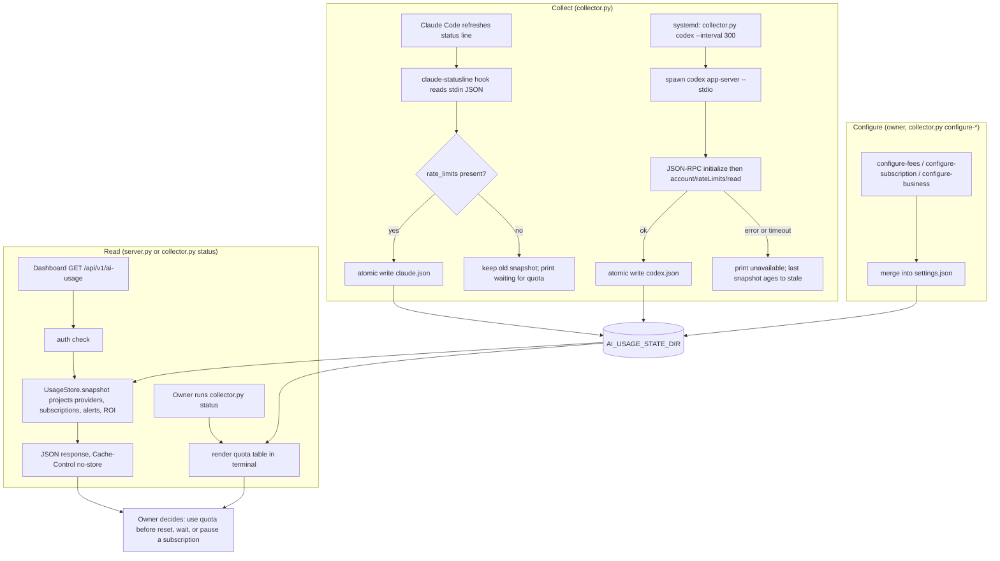

# 01 — Business process (As-Is / To-Be)

ระบบนี้คือ **ai-usage**: CLI (`collector.py`, standard library เท่านั้น) + HTTP API แบบ read-only (`server.py`) ที่รันในเครื่องของเจ้าของ (local-first, systemd user units) เพื่อตอบคำถามเดียว: "โควตา Claude / Codex เหลือเท่าไร รีเซ็ตเมื่อไร และค่า AI รายเดือนคุ้มไหม" โดยไม่ใช้โควตาเอง ไม่เก็บ prompt / reply / account id / credential

## As-Is (จาก code วันนี้)

ขั้นตอนธุรกิจจริงที่ code รองรับ:

1. **เก็บโควตา** — Claude ผ่าน status-line callback (`ingest_claude`), Codex ผ่าน polling ทุก 300 วินาที (`read_codex`); เก็บเฉพาะ allowlist field
2. **ตั้งค่าตัวเลขธุรกิจ** — ค่าสมาชิก (USD สำหรับ Claude/Codex, THB สำหรับทั้ง 5 เจ้า), plan, `active_days_30d`, รายได้ / กำไรก่อนหักค่า AI รายเดือน
3. **อ่าน / ตัดสินใจ** — `status` ใน terminal หรือ dashboard ผ่าน API; API คำนวณ alert (`quota_low` 85%, `quota_reached` 100%, `use_before_reset`) และ ROI (`target_ratio` 3, budget band 5–10% ของรายได้) ใหม่ทุก request; backend ไม่ส่ง notification ภายนอก

Sources: `collector.py` (`ingest_claude`, `read_codex`, `main`, `update_settings`), `server.py` (`AiUsageApi.handle`), `model.py` (`UsageStore.snapshot`, `window_alerts`, `project_roi`), `systemd/solo-ai-usage-collector.service`, `PRODUCT.md`, `contracts/ai-usage.v1.md`

## To-Be

ไม่มี `docs/UPGRADE-PLAN.md` และ `specs/` มีเพียง SPEC-001 (CI coverage gate) และ SPEC-002 (L2 baseline: lock, mypy, Ruff, Sentry) ซึ่งเป็นงาน tooling ไม่เปลี่ยน business process สิ่งที่ repo docs ระบุว่า "ยังไม่ทำ" (out of scope ใน `PRODUCT.md`):

- billed API spend (`api_billed_cost_usd` เป็น `null` เสมอ)
- quota collector ของ Gemini, Grok, Muse (ตอนนี้เป็น cost-only)
- write route ใด ๆ

Sources: `PRODUCT.md` (Capabilities and Constraints), `specs/README.md`, `specs/001-coverage-gate/spec.md`, `specs/002-l2-baseline/spec.md`, `DOCPACK/00-product-card.md` §8

## Open questions

- To-Be process: ไม่มีเอกสารแผน จะเพิ่ม collector ของ Gemini / Grok / Muse หรือ billed API spend หรือไม่
- dashboard ตัวไหนอ่าน API อยู่จริงวันนี้ (`PRODUCT.md` ระบุ `[ต้องยืนยัน]`; `docs/OWNER.th.md` บอก `owner-web` / `bookchaowalit/life-dashboard-web`; registry ระบุ relay `ai-usage-display` บน Railway)
