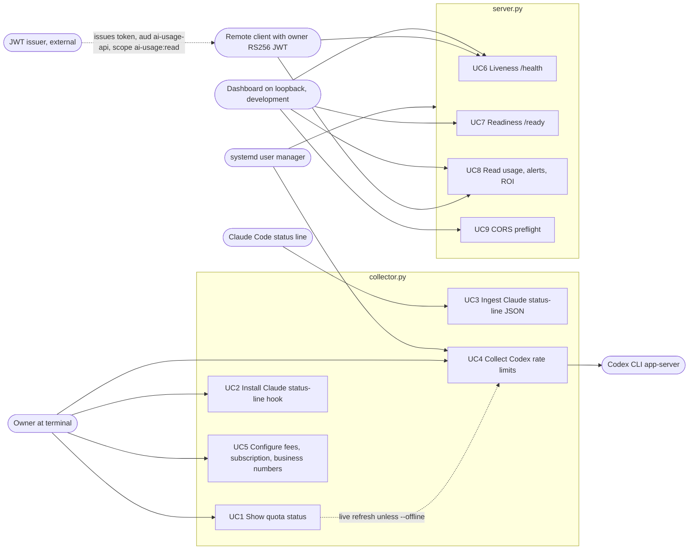

# 02 — Use cases

Actors มาจาก role / auth level จริงใน code: เจ้าของที่ terminal (ไม่มี auth, เข้าถึงไฟล์ในเครื่อง), Claude Code (ส่ง stdin ให้ hook), Codex app-server (ถูกเรียกเป็น subprocess), dashboard client (HTTP; auth ขึ้นกับ mode), systemd (รัน collector / API), JWT issuer (ภายนอก ออก RS256 token; API ตรวจด้วย public key ในเครื่อง)

| Actor | Auth level in code | Use cases |
|---|---|---|
| Owner (terminal) | OS user; files `0600`, dir `0700` (`atomic_json`) | UC1, UC2, UC4, UC5 |
| Claude Code | local process, stdin ≤ 1 MiB | UC3 |
| Codex app-server | subprocess; uses its own login, collector never reads credential files | UC4 (callee) |
| Dashboard on loopback | `environment=development`, no policy configured → no auth, or static `AI_USAGE_API_TOKEN` bearer | UC6–UC9 |
| Remote client | non-loopback bind forces `production`; RS256 JWT `aud=ai-usage-api`, `scope=ai-usage:read`, `tenant_id=owner`, `sub` in `AI_USAGE_API_AUTH_SUBJECTS`, lifetime ≤ 120 s | UC8 (UC6 public) |
| Browser origin | must be in `AI_USAGE_API_CORS_ORIGINS` (default `http://127.0.0.1:3600`, `http://localhost:3600`) else 403 | UC8, UC9 |

Sources: `collector.py` (`main` command choices, `atomic_json`, `ingest_claude`, `read_codex`, `install_claude`), `server.py` (`handle`, `_dispatch`, `main`), `vendor/service-auth/service_auth/__init__.py` (`check_read_auth`, `AuthPolicy.authenticate`), `systemd/*.service`, `contracts/ai-usage.v1.md`

## Open questions

- ใครคือ JWT issuer จริง (ค่า `AI_USAGE_API_AUTH_ISSUER`) และมี client ไหนใช้ production mode อยู่หรือไม่ — repo ไม่ระบุ
