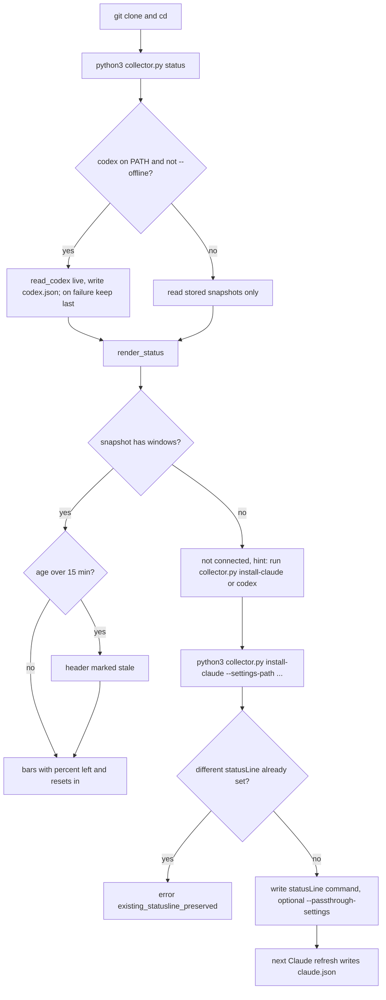
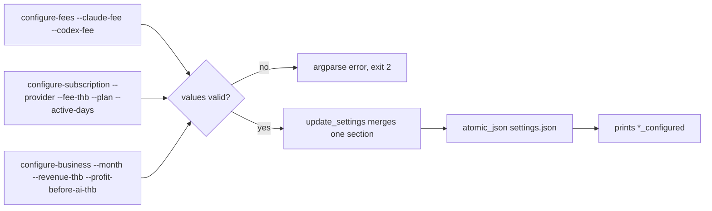
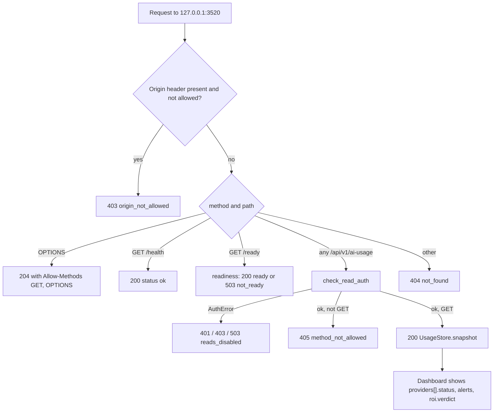

# 03 — User flows

ไม่มี UI ใน repo นี้ flow จึงเป็น CLI commands (`collector.py`) และ HTTP routes (`server.py`) ต่อ role

## Flow A — Owner: ติดตั้งและดูโควตา

## Flow B — Owner: ตั้งค่าตัวเลขค่าใช้จ่ายและธุรกิจ

## Flow C — Dashboard: อ่านข้อมูลผ่าน API

Sources: `collector.py` (`main`, `render_status`, `install_claude`, `update_settings`), `server.py` (`_dispatch`, `handle`, `_write`), `vendor/service-auth/service_auth/__init__.py` (`readiness`, `check_read_auth`), `README.md` (Quick start, Commands)

## Open questions

- หน้า dashboard ที่แสดงข้อมูลนี้อยู่นอก repo (`docs/OWNER.th.md` อ้าง `owner-web`); flow ฝั่ง browser notification อยู่ใน frontend นั้น ไม่ได้วาดที่นี่
