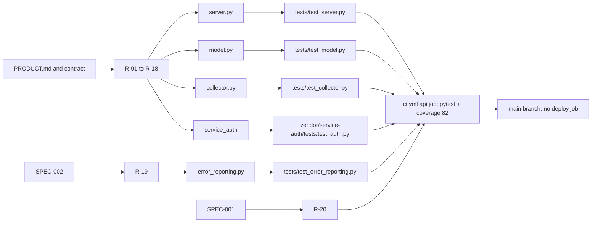

# 04 — Traceability (RTM)

Requirements มาจาก `PRODUCT.md` (Capabilities and Constraints), `contracts/ai-usage.v1.md` และ acceptance criteria ใน `specs/` ทุกแถวชี้ code และ test ที่มีอยู่จริง Release / workflow: ทุกแถวถูก gate โดย `.github/workflows/ci.yml` (job `api` + `security`); ไม่มี deploy pipeline (ดู 15, 16)

| ID | Requirement (source) | Code module | Test file :: test | Release / workflow |
|---|---|---|---|---|
| R-01 | Routes `/health`, `/ready`, `/api/v1/ai-usage`, `OPTIONS`; 404 unknown, 405 non-GET (PRODUCT.md, contract) | `server.py` `AiUsageApi.handle` | `tests/test_server.py::test_read_only_routes_and_unknown_providers` | ci.yml `api` |
| R-02 | Beyond loopback: production + RS256 owner JWT, refuse start without `AI_USAGE_API_AUTH_*` (PRODUCT.md) | `server.py` `main`; `service_auth.AuthPolicy` | `tests/test_server.py::test_remote_bind_requires_owner_auth_even_in_development`, `::test_production_static_token_and_partial_policy_fail_closed` | ci.yml `api` |
| R-03 | JWT `aud`, `scope`, `tenant_id=owner`, allowed `sub`, lifetime ≤ 120 s (contract) | `service_auth.AuthPolicy.authenticate` | `tests/test_server.py::test_owner_jwt_audience_scope_and_claims`; `vendor/service-auth/tests/test_auth.py` (`test_time_bounds_and_types`, `test_owner_and_scope_authorization`, …) | ci.yml `api` (pytest also collects vendor tests) |
| R-04 | CORS allowlist, `Cache-Control: no-store`, no path exposure (OWNER.th.md, contract) | `server.py` `_dispatch`, `_write` | `tests/test_server.py::test_actual_http_cors_cache_and_no_snapshot_path_exposure` | ci.yml `api` |
| R-05 | Generic 500 with no exception text (PRODUCT.md) | `server.py` `handle` except branch | `tests/test_server.py::test_expected_source_errors_never_disclose_exception_text`; `tests/test_error_reporting.py::test_an_unexpected_api_error_is_reported_and_still_answers_a_generic_500` (SPEC-002 AC-06) | ci.yml `api` |
| R-06 | Snapshot ≤ 1 MiB, no symlinks (any component), no FIFO, duplicate keys rejected (contract) | `model.py` `read_snapshot`, `_open_directory`, `_unique_object` | `tests/test_model.py::test_bad_json_duplicate_fields_or_oversized_files_are_safe_errors`, `::test_symlink_snapshot_directory_and_ancestor_are_never_read`, `::test_fifo_never_blocks`, `::test_settings_symlink_does_not_publish_fees` | ci.yml `api` |
| R-07 | Stale > 900 s (no alerts); future > 60 s = error; clamp 0..100; remaining recomputed; expired window has no remaining (PRODUCT.md) | `model.py` `project_provider`, `project_window` | `tests/test_model.py::test_stale_snapshot_has_no_alerts_and_retains_observed_usage`, `::test_invalid_metadata_and_far_future_are_safe_errors`, `::test_expired_window_retains_history_without_remaining_or_alerts`, `::test_invalid_percentage_never_becomes_zero_or_alert` | ci.yml `api` |
| R-08 | Alerts `quota_low` 85%, `quota_reached` 100%, `use_before_reset` ≥ 30% within 6 h / 24 h (PRODUCT.md) | `model.py` `window_alerts` | `tests/test_model.py::test_alert_thresholds_and_actual_duration`, `::test_alert_id_changes_for_reset_cycle_only`, `::test_exhausted_other_window_blocks_use_before_reset_for_each_provider`, `::test_missing_reset_is_unknown_and_suppresses_all_alerts` | ci.yml `api` |
| R-09 | Allowlisted plans, window ids; duplicate ids dropped (contract) | `model.py` `PLANS`, `PROVIDER_WINDOWS`, `project_provider` | `tests/test_model.py::test_plan_labels_are_allowlisted`, `::test_duplicate_and_unknown_window_ids_are_discarded` | ci.yml `api` |
| R-10 | Fees owner-entered, env overrides settings, never inferred (PRODUCT.md) | `model.py` `monthly_fee`, `env_or_setting` | `tests/test_model.py::test_fees_from_settings_env_override_and_missing_total`, `::test_env_overrides_and_invalid_values_are_unknown` | ci.yml `api` |
| R-11 | 5 subscriptions, `consider_pausing` on near-zero use (PRODUCT.md) | `model.py` `project_subscription`, `quota_usage` | `tests/test_model.py::test_v1_providers_unchanged_and_all_five_subscriptions_listed`, `::test_near_zero_usage_flags_consider_pausing`, `::test_measured_quota_beats_self_report_and_stale_is_unknown` | ci.yml `api` |
| R-12 | ROI ratio vs target 3, budget band 5–10%, no ratio from partial spend (contract) | `model.py` `project_roi` | `tests/test_model.py::test_ratio_and_budget_band`, `::test_missing_fee_or_profit_never_produces_a_ratio` | ci.yml `api` |
| R-13 | Collector never uses quota: Codex only `initialize` + `account/rateLimits/read` (README) | `collector.py` `read_codex`, `rpc_result` | `tests/test_collector.py::test_codex_transport_only_initializes_and_reads_account_metadata`, `::test_codex_transport_timeout_terminates_its_process`, `::test_codex_transport_does_not_return_provider_error_payload` | ci.yml `api` |
| R-14 | Store only allowlisted quota fields; invalid never becomes 0 (README) | `collector.py` `claude_snapshot`, `codex_snapshot`, `window` | `tests/test_collector.py::test_claude_keeps_only_documented_quota_and_session_estimate`, `::test_invalid_quota_never_becomes_zero`, `::test_unknown_duration_not_invented`, `::test_malformed_plan_and_huge_numeric_values_remain_unknown` | ci.yml `api` |
| R-15 | Private atomic writes, symlink rejection (README) | `collector.py` `atomic_json` | `tests/test_collector.py::test_atomic_metadata_is_private_and_symlinks_rejected`, `::test_symlink_ancestor_is_rejected_before_creation` | ci.yml `api` |
| R-16 | Hook install never overwrites an existing status line; passthrough no recursion (README) | `collector.py` `install_claude`, `statusline_command`, `ingest_claude` | `tests/test_collector.py::test_statusline_install_preserves_other_settings_and_is_idempotent`, `::test_different_local_statusline_is_never_overwritten`, `::test_statusline_passthrough_does_not_recurse_or_publish_settings` | ci.yml `api` |
| R-17 | `configure-*` merge without deleting other sections (OWNER.th.md) | `collector.py` `update_settings` | `tests/test_collector.py::test_configure_commands_merge_settings_sections` | ci.yml `api` |
| R-18 | `status` table, stale marking, `--offline` (README) | `collector.py` `render_status`, `main` | `tests/test_collector.py::test_status_renders_fresh_stale_and_missing_providers`, `::test_status_command_reads_stored_snapshots_offline` | ci.yml `api` |
| R-19 | SPEC-002 AC-01…AC-05: Sentry opt-in, errors only, scrubbed | `error_reporting.py` | `tests/test_error_reporting.py` (5 tests, one per AC) | ci.yml `api` |
| R-20 | SPEC-001 AC-01…AC-03: coverage gate, service modules only | `pyproject.toml` `[tool.coverage.run]`; ci.yml `coverage-threshold: "82"` | CI runs (SPEC-001 red/green log: `e5b739e` red, `87f8b33` green) | ci.yml `api` (shared `ci-python.yml` v1.1.1) |

Sources: `PRODUCT.md`, `contracts/ai-usage.v1.md`, `README.md`, `docs/OWNER.th.md`, `specs/001-coverage-gate/spec.md`, `specs/002-l2-baseline/spec.md`, `server.py`, `model.py`, `collector.py`, `error_reporting.py`, `vendor/service-auth/service_auth/__init__.py`, `tests/*.py`, `vendor/service-auth/tests/test_auth.py`, `.github/workflows/ci.yml`

## Open questions

- SPEC-002 ยัง `in review` (owner approval pending) และตาราง §4 Interfaces ใน spec เสีย (มีตัวอักษรทีละช่อง) — ต้องให้ owner แก้ / อนุมัติ
- `specs/README.md` ยังไม่ list SPEC-002
- ไม่มี requirement ID ทางการใน PRODUCT.md; R-xx ข้างบนตั้งขึ้นเพื่อ RTM นี้เท่านั้น
