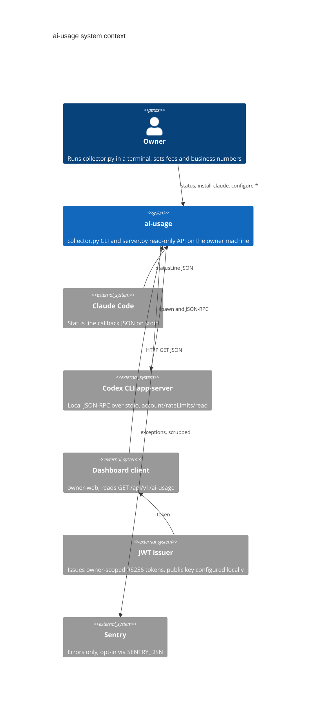

# 05 — C4 Context

ผู้ใช้หลักคือเจ้าของคนเดียว ระบบไม่ติดต่อ provider cloud API ตรง ๆ: Claude ส่งข้อมูลเข้ามาเอง (stdin) และ Codex อ่านผ่าน CLI ที่ล็อกอินอยู่แล้ว JWT ตรวจด้วย public key ในเครื่อง (ไม่เรียก issuer ทาง network)

Sources: `README.md`, `PRODUCT.md` (Users, Operating Context), `collector.py` (`ingest_claude`, `read_codex`), `server.py`, `vendor/service-auth/service_auth/__init__.py` (`AuthPolicy.from_env`, local `load_pem_public_key`), `error_reporting.py`, `docs/OWNER.th.md`

## Open questions

- Dashboard client ที่ใช้งานจริง: `owner-web` (`docs/OWNER.th.md`); relay `ai-usage-display` ไม่ได้อ่าน API นี้ แต่รับ snapshot ที่ `platform-ai-usage-display` push ไป (ดู 16-deployment)
- Sentry DSN ตั้งไว้กับ local units หรือไม่ (PRODUCT.md `[ต้องยืนยัน]`)
