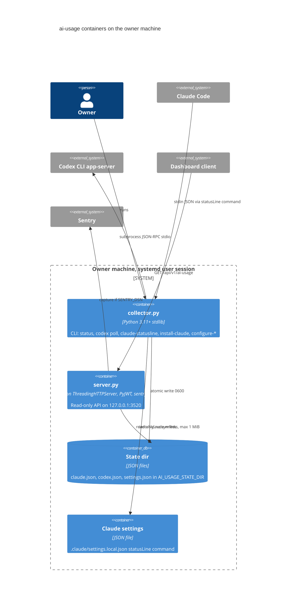

# 06 — C4 Container

Optional container: `Dockerfile` สร้าง image `python:3.12-slim` (`AI_USAGE_API_HOST=0.0.0.0`, `AI_USAGE_API_ENV=production`, state `/app/state` mount read-only) แต่ `service.yaml` `deploy.target: unassigned` จึงไม่ได้วาดเป็น container ที่รันอยู่

Sources: `systemd/solo-ai-usage-api.service`, `systemd/solo-ai-usage-collector.service`, `server.py`, `collector.py`, `model.py` (`read_snapshot`, `default_state_dir`), `pyproject.toml`, `Dockerfile`, `service.yaml`, `error_reporting.py`

## Open questions

- Docker image รันที่ไหนหรือไม่ (PRODUCT.md `[ต้องยืนยัน]`)
