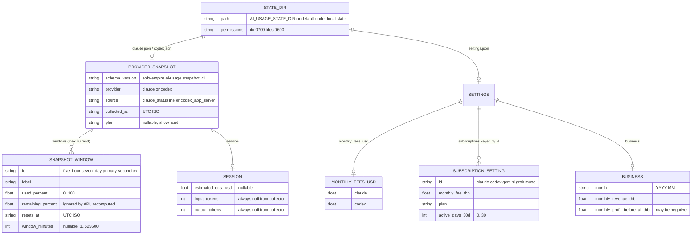
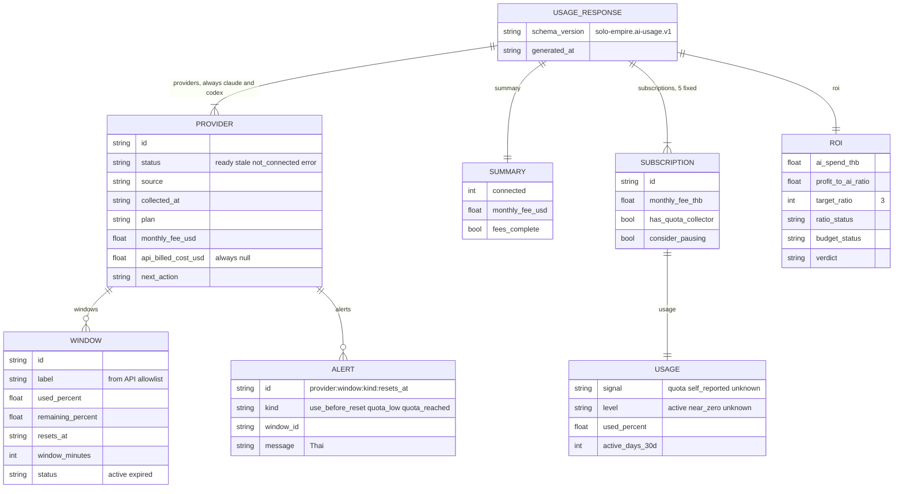

# 09 — ERD

ไม่มี database: ข้อมูลที่ persist คือ JSON 3 ไฟล์ใน `AI_USAGE_STATE_DIR` (ADR-0004) ERD ข้างล่างวาด document model ของไฟล์ (persisted) และ response projection ของ `GET /api/v1/ai-usage` (ไม่ persist, คำนวณใหม่ทุก request) แยกกัน

## Persisted files

## Response projection (not persisted)

Sources: `collector.py` (`claude_snapshot`, `codex_snapshot`, `window`, `update_settings`, `main` configure-*), `model.py` (`read_snapshot`, `project_provider`, `project_window`, `window_alerts`, `project_subscription`, `project_roi`, `UsageStore.snapshot`), `contracts/ai-usage.v1.md`
