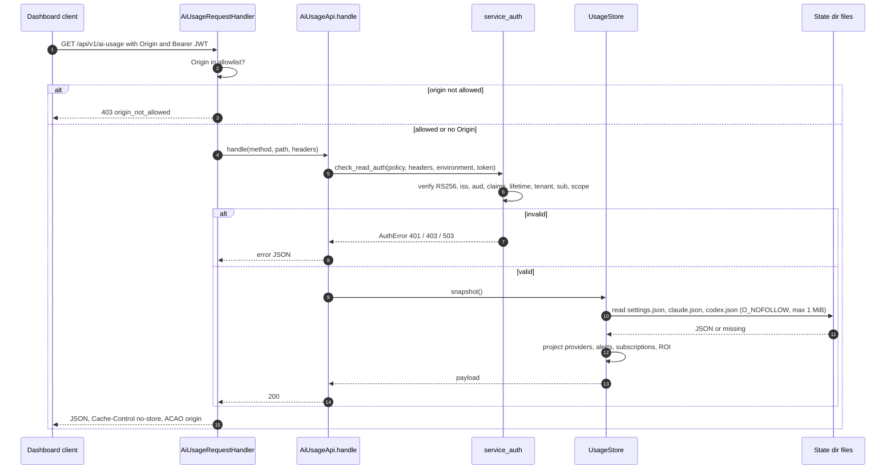
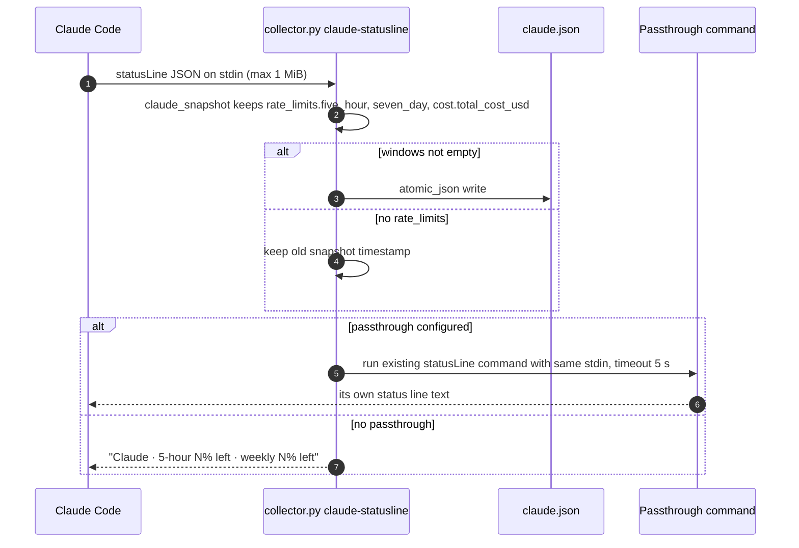
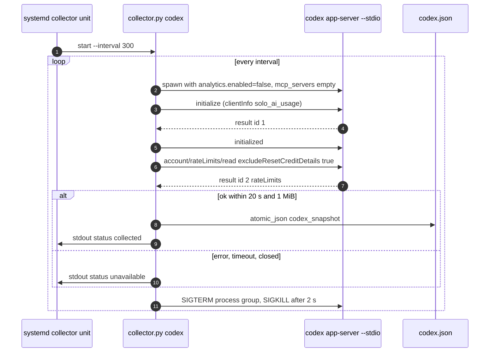

# 10 — Sequences

## S1 — Dashboard reads usage (production JWT path)

## S2 — Claude status-line ingest

## S3 — Codex collection (systemd poll every 300 s)

Sources: `server.py` (`_dispatch`, `handle`, `_write`), `vendor/service-auth/service_auth/__init__.py`, `model.py` (`UsageStore.snapshot`, `read_snapshot`), `collector.py` (`ingest_claude`, `claude_snapshot`, `read_codex`, `rpc_result`, `main` loop), `systemd/solo-ai-usage-collector.service`
