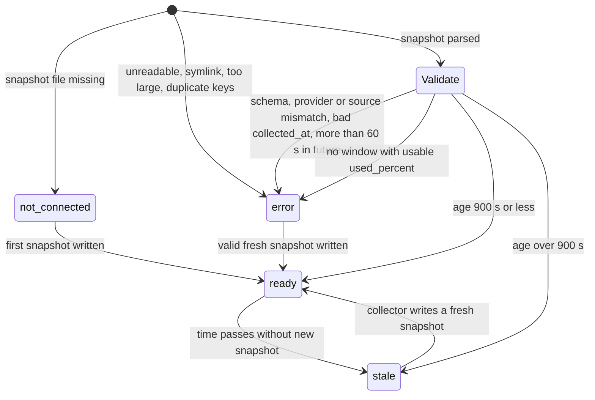
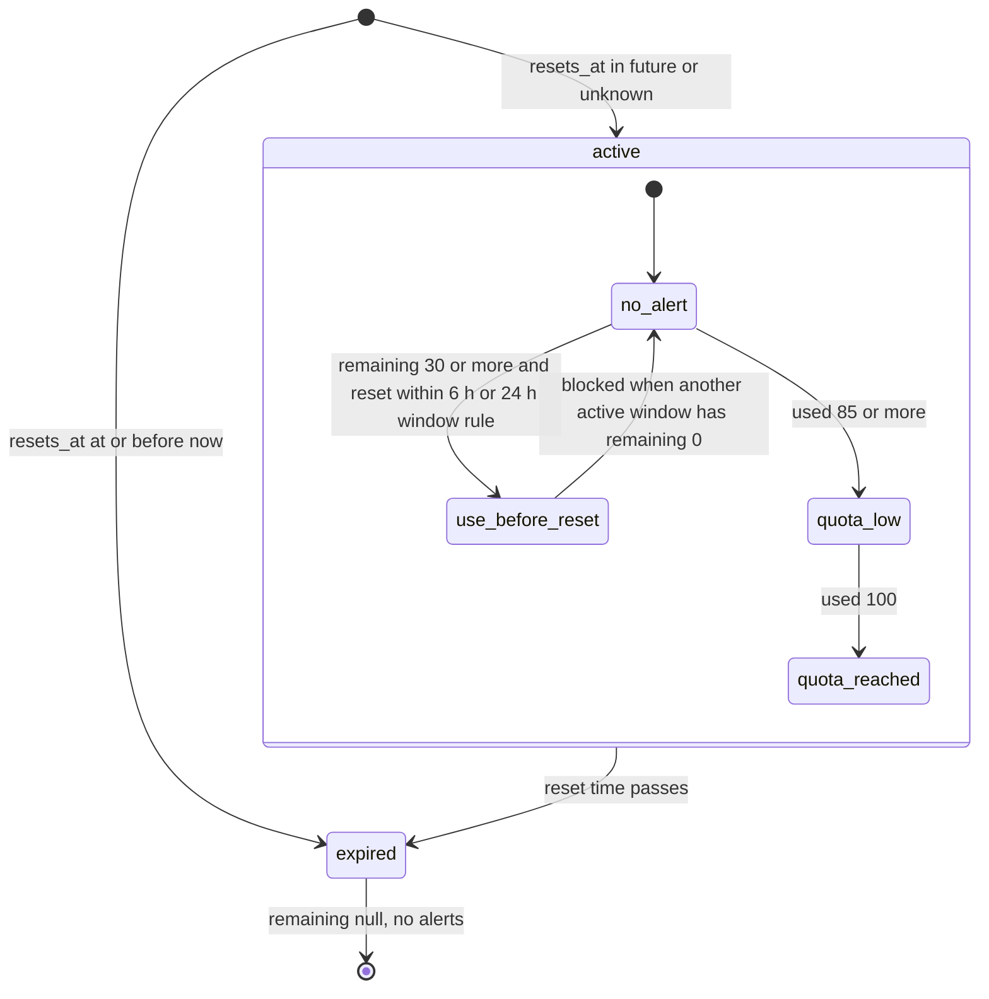
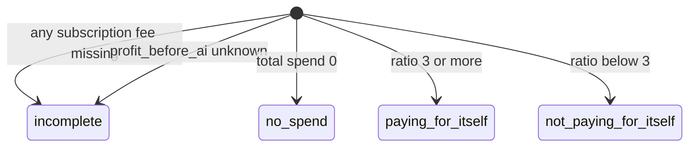
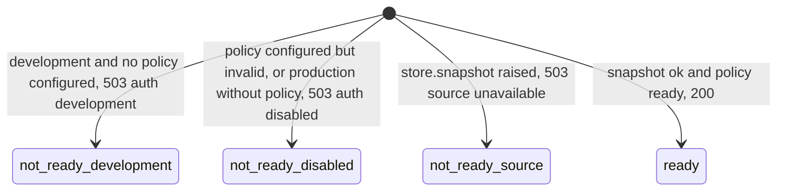

# 11 — State machines

## Provider status (`providers[].status`, computed per request)

`next_action`: `not_connected` → `connect_provider`; `error` → `check_source`; `stale` → `refresh_usage`; `ready` → `quota_reached` / `quota_low` / `use_before_reset` (ตามลำดับความสำคัญ) หรือ `monitor`

## Quota window (`windows[].status`) and alerts

## ROI verdict (`roi.verdict`)

## API readiness (`/ready`)

Sources: `model.py` (`project_provider`, `empty_provider`, `project_window`, `window_alerts`, `quota_usage`, `project_roi`, `STALE_SECONDS`, `FUTURE_TOLERANCE_SECONDS`), `vendor/service-auth/service_auth/__init__.py` (`readiness`), `contracts/ai-usage.v1.md`
