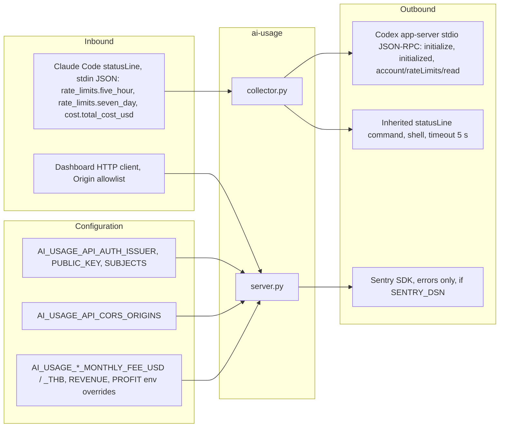

# 12 — API and integrations

Field reference เต็มอยู่ใน contract เดิม — **reused**: [`contracts/ai-usage.v1.md`](../../contracts/ai-usage.v1.md) (ไม่ copy) ที่นี่สรุป endpoint และ integration flows

## Endpoints (`server.py`, default `127.0.0.1:3520`)

| Method | Path | Auth | Responses |
|---|---|---|---|
| GET | `/health` | none | 200 `{status, service, schema_version, timestamp}` |
| GET | `/ready` | none | 200 ready / 503 not_ready (`status`, `source`, `auth`) |
| GET | `/api/v1/ai-usage` | `check_read_auth` | 200 usage; 401 `unauthorized`; 403 `forbidden`; 503 `reads_disabled`; 500 `internal_error` |
| POST / PUT / PATCH / DELETE | `/api/v1/ai-usage` | `check_read_auth` first | 405 `method_not_allowed` |
| OPTIONS | any | none | 204, `Access-Control-Allow-Methods: GET, OPTIONS`, `Allow-Headers: Accept, Authorization` |
| any | other path | none | 404 `not_found` |
| any | any, disallowed `Origin` | — | 403 `origin_not_allowed` |

## External integrations

| Integration | Direction | Contract used | Code |
|---|---|---|---|
| Claude Code status line | in (stdin) | documented statusLine JSON; reads `rate_limits.{five_hour,seven_day}.{used_percentage,resets_at}`, `cost.total_cost_usd` | `collector.py` `claude_snapshot`, `ingest_claude` |
| Codex app-server | out (subprocess) | JSON-RPC lines: `initialize` (`clientInfo.name=solo_ai_usage`), `initialized`, `account/rateLimits/read` (`excludeResetCreditDetails: true`); reads `rateLimits.{primary,secondary}.{usedPercent,resetsAt,windowDurationMins}`, `planType` | `collector.py` `read_codex`, `rpc_result`, `codex_snapshot` |
| Claude settings file | out (file write) | `statusLine: {type: command, command}` | `collector.py` `install_claude` |
| JWT issuer | config only | RS256 PEM public key; no JWKS fetch | `service_auth.AuthPolicy.from_env` |
| Sentry | out (HTTPS by SDK) | `sentry-sdk>=2.72,<3` | `error_reporting.py` |
| Dashboard | in (HTTP) | `contracts/ai-usage.v1.md` | `server.py` |

Sources: `server.py`, `collector.py`, `error_reporting.py`, `vendor/service-auth/service_auth/__init__.py`, `model.py` (env keys), `pyproject.toml`, `contracts/ai-usage.v1.md`, `README.md`

## Open questions

- ยืนยันว่า `owner-web` เป็น consumer เดียวของ API (relay `ai-usage-display` รับ push ไม่ได้เรียก API)
