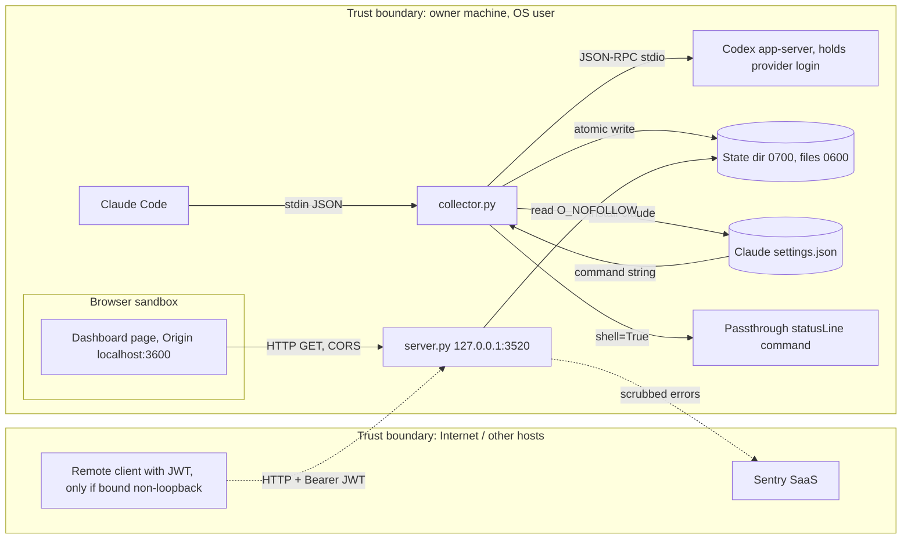

# 13 — Threat model (DFD + STRIDE)

## STRIDE per element

| Element | Threat (STRIDE) | Existing mitigation in code | Gap |
|---|---|---|---|
| server.py API | **S** spoofed caller | non-loopback → production + RS256 owner JWT; refuse start without policy (`server.main`, `AuthPolicy`) | on loopback in development with no policy and no token, any local process can read usage |
| server.py API | **T** tampering via write | no write route; non-GET → 405 | — |
| server.py API | **R** repudiation | — | no access log (`log_message` returns), `jti` not recorded |
| server.py API | **I** info disclosure | generic 500 without exception text; `/ready` publishes only 3 enums; `Cache-Control: no-store`, `nosniff`; Origin allowlist | `/health` public (service name, schema version only) |
| server.py API | **D** DoS | `ThreadingHTTPServer`; snapshot read capped at 1 MiB | no rate limit, no request timeout, no max header size control beyond stdlib |
| server.py API | **E** privilege | single read scope `ai-usage:read`, `tenant_id=owner`, subject allowlist | — |
| JWT validation | **S/T** forged or replayed token | `alg=RS256` only, rejects `jku/jwk/x5u/x5c/crit`, key ≥ 2048, `strict_aud`, lifetime ≤ 120 s, `iat` within 125 s | `jti` not stored → replay possible within token lifetime |
| Browser → API | **S** CSRF / cross-origin read | Origin not in allowlist → 403; ACAO only for allowed origin | requests without `Origin` header are not origin-checked (auth still applies) |
| State dir | **T** symlink / swap attack | reader: `O_NOFOLLOW` on every component, regular file only, `O_NONBLOCK` vs FIFO; writer: parent `resolve()` check, `is_symlink`, `mkstemp` + `os.replace`, `0700/0600` | `collector.read_snapshot` / `read_settings` check only the final path for symlinks |
| State dir | **I** sensitive data stored | allowlist only: percentages, reset time, plan label, cost estimate; no prompts, account ids, credentials | `settings.json` holds owner revenue / profit numbers in plain JSON |
| collector → Codex | **I/E** collector reads credentials or spends quota | only `initialize` + `account/rateLimits/read`, `analytics.enabled=false`, `mcp_servers={}`, stderr discarded, provider errors never returned | relies on the `codex` binary found on `PATH` or `AI_USAGE_CODEX_BIN` |
| collector → Codex | **D** hang | 20 s deadline, 1 MiB cap, kill process group | — |
| Claude stdin | **T** malformed input | 1 MiB cap, numeric bounds, allowlisted windows | — |
| Passthrough command | **E** command injection | command only from the local settings file written by the installer; `collector.py` commands excluded to avoid recursion; timeout 5 s | runs with `shell=True`; anyone who can edit the Claude settings file can run commands (same OS user) |
| Sentry egress | **I** secrets in events | no PII, no locals, no body, request reduced to method, regex scrub of URL passwords, tokens, bearer, JWT | opt-in; DSN presence unknown |
| CI supply chain | **T** dependency / action | `uv.lock --frozen`, actions pinned by SHA in shared workflows, gitleaks, semgrep, osv-scanner, trivy-fs; Renovate | `main` not branch-protected (GitHub API 404 "Branch not protected", 2026-11-03) |

Sources: `server.py`, `vendor/service-auth/service_auth/__init__.py`, `model.py` (`read_snapshot`, `_open_directory`), `collector.py` (`atomic_json`, `read_settings`, `read_codex`, `ingest_claude`, `statusline_command`, `install_claude`, `read_snapshot`), `error_reporting.py`, `.github/workflows/ci.yml`, platform-ci-workflows `security.yml` @ `87dc5e1`, `gh api repos/bookchaowalit/platform-ai-usage-api/branches/main/protection`

## Open questions

- ต้องการ replay protection (`jti` cache) หรือ rate limit หรือไม่ ถ้าจะเปิด API นอก loopback
- ควรบังคับ static token แม้ใน loopback development หรือไม่ (เครื่องมีหลาย process / user)
