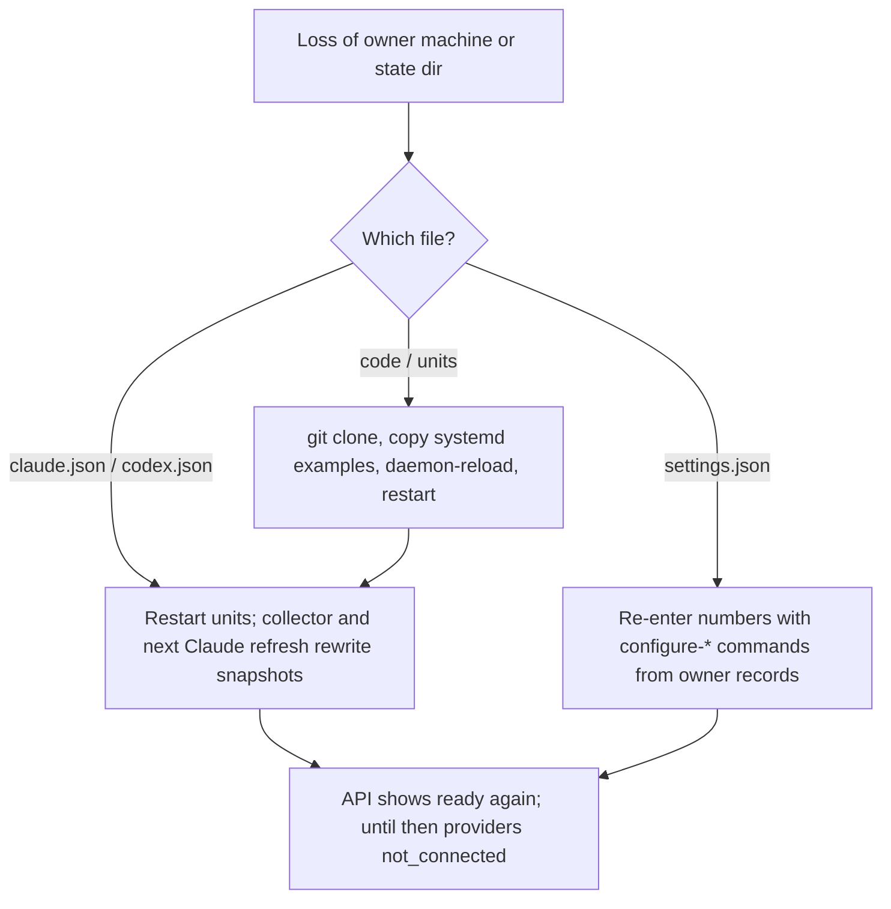

# 14 — Backup / DR

| Data | Where | Created by | Regenerable? | Backup in repo / provider |
|---|---|---|---|---|
| `claude.json` | `AI_USAGE_STATE_DIR` (default `~/.local/state/solo-empire/ai-usage/`) | `collector.py claude-statusline` on each Claude refresh | yes, next status-line refresh | none |
| `codex.json` | same | `collector.py codex` (every 300 s) or `status` | yes, next poll | none |
| `settings.json` | same | owner via `configure-fees`, `configure-subscription`, `configure-business` | **no** — owner-entered fees, plans, active days, revenue, profit | none |
| Claude `statusLine` setting | `.claude/settings.local.json` of a project, or `~/.claude/settings.json` | `install-claude` | yes, re-run `install-claude` | none |
| Code | GitHub `bookchaowalit/platform-ai-usage-api` (public) | git | yes | GitHub |

- ไม่มี backup workflow ใน repo (`.github/workflows/` มีแค่ `ci.yml`) และไม่มี DB (ADR-0004) จึงไม่อยู่ใน nightly DB backup ของ platform
- **RTO / RPO: not defined** ใน repo docs ใด ๆ
- Recovery steps ของ systemd อยู่ใน `docs/OWNER.th.md` (`systemctl --user daemon-reload && systemctl --user restart solo-ai-usage-api solo-ai-usage-collector`)

Sources: `model.py` (`default_state_dir`, `read_snapshot`), `collector.py` (`state_dir`, `atomic_json`, `update_settings`, `install_claude`), `service.yaml` (`data`), `.github/workflows/ci.yml`, `docs/OWNER.th.md`, `README.md`

## Open questions

- `settings.json` ควรถูก backup ที่ไหน (เช่นอยู่ใน home backup ของเครื่อง) — ไม่ระบุใน repo
- RTO / RPO ที่ยอมรับได้
