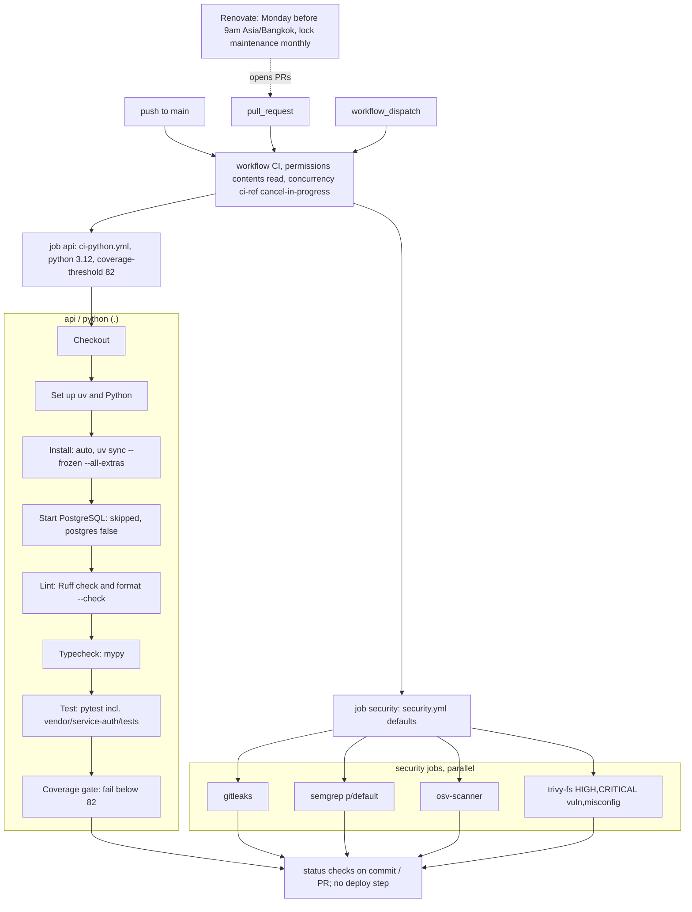

# 15 — CI/CD pipeline

workflow เดียว: `.github/workflows/ci.yml` (name `CI`) เรียก reusable workflows ของ `bookchaowalit/platform-ci-workflows` pin SHA `87dc5e1c…` (v1.1.1) runner default `"ubuntu-24.04"` (GitHub-hosted, public repo) ไม่มี CD job

- ไม่มี `needs:` ระหว่าง `api` และ `security` (รันขนาน)
- ตัวอย่าง run จริง: `api / python (.)`, `security / semgrep`, `security / gitleaks`, `security / osv-scanner`, `security / trivy-fs` (run 39019148129)

Sources: `.github/workflows/ci.yml`, platform-ci-workflows @ `87dc5e1` `.github/workflows/ci-python.yml` / `security.yml` (local clone `~/work/oa-infra/platform-ci-workflows`, read-only), `renovate.json`, `gh run view 39019148129 --json jobs`
