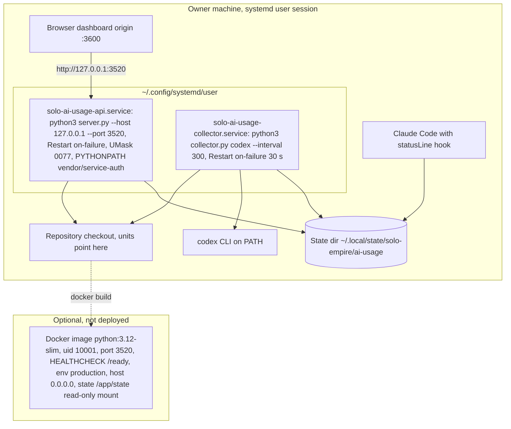

# 16 — Deployment

ไม่มี hosted deployment (`service.yaml` `deploy.target: unassigned`, ADR-0001) runtime จริงคือ systemd user units บนเครื่องของเจ้าของ

| Item | Value | Source |
|---|---|---|
| Bind | `127.0.0.1:3520` (env `AI_USAGE_API_HOST`, `AI_USAGE_API_PORT`, or PaaS `PORT`) | `server.py` `main`, systemd unit |
| Environment | `development` on loopback; forced `production` on non-loopback | `server.py` |
| CORS origins | `http://127.0.0.1:3600`, `http://localhost:3600` default | `server.py` |
| Domain / TLS | none | — |
| Data store | local JSON files | `model.py`, `service.yaml` |
| Secrets | `service.yaml` `secrets: []`; auth via `AI_USAGE_API_AUTH_*` env when needed | `service.yaml`, `docs/OWNER.th.md` |

Sources: `systemd/solo-ai-usage-api.service`, `systemd/solo-ai-usage-collector.service`, `docs/OWNER.th.md` (systemd บนเครื่องนี้), `service.yaml`, `Dockerfile`, `server.py`, `PRODUCT.md` (Operating Context)

## Open questions

- relay `ai-usage-display` บน Railway ไม่ได้อ่าน API นี้ (ตรวจ 2026-11-04): เป็น push mode จาก `relay-push.mjs` ของ `platform-ai-usage-display`; ยังไม่รู้ว่า pusher รันบนเครื่องไหน (ไม่ใช่ WSL นี้หรือ Windows host)
- Docker image ถูก build / รันที่ไหนหรือไม่
