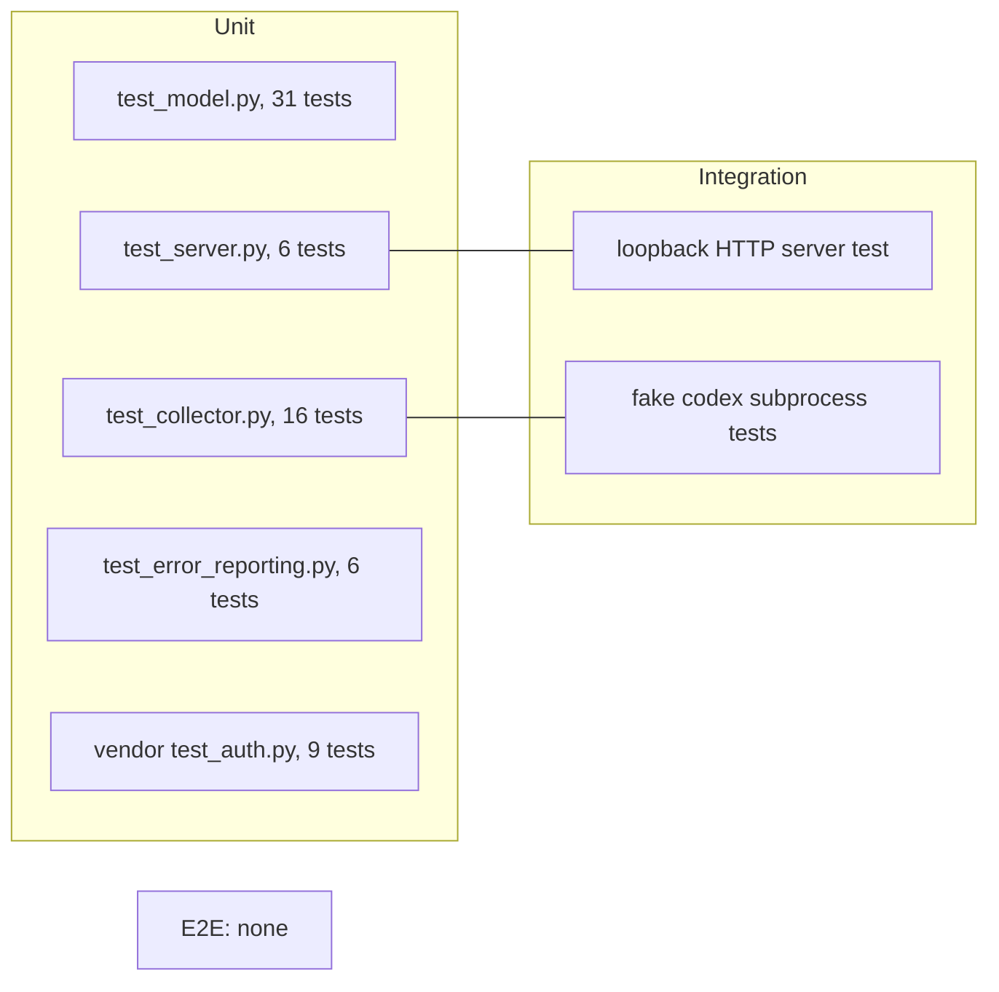

# 17 — Test coverage matrix

Test levels ใน repo: **unit** (function / in-process `AiUsageApi.handle`), **integration** (จริงผ่าน loopback HTTP `ThreadingHTTPServer`, หรือ subprocess fake `codex` binary), **e2e** ไม่มี (ไม่มี test ที่ใช้ Claude Code / Codex จริงหรือ dashboard) Coverage gate 82% (measured 84.01% on 2026-10-22 ตาม comment ใน `ci.yml`)

| Feature | Unit | Integration | E2E | Test files |
|---|---|---|---|---|
| Routing, 404 / 405 | ✅ | ✅ | ❌ | `tests/test_server.py` |
| JWT auth, fail-closed, static token | ✅ | — | ❌ | `tests/test_server.py`, `vendor/service-auth/tests/test_auth.py` |
| CORS, `no-store`, no path exposure | — | ✅ real loopback HTTP | ❌ | `tests/test_server.py::test_actual_http_cors_cache_and_no_snapshot_path_exposure` |
| Generic 500, no exception text | ✅ | — | ❌ | `tests/test_server.py`, `tests/test_error_reporting.py` |
| Snapshot file safety (symlink, FIFO, size, duplicate keys) | ✅ real filesystem | — | ❌ | `tests/test_model.py` |
| Provider status / freshness | ✅ | — | ❌ | `tests/test_model.py` |
| Window projection, alerts | ✅ | — | ❌ | `tests/test_model.py` |
| Fees, env overrides | ✅ | — | ❌ | `tests/test_model.py` |
| Subscriptions, `consider_pausing`, ROI | ✅ | — | ❌ | `tests/test_model.py` (`SubscriptionRoiTest`) |
| Claude snapshot parsing | ✅ | — | ❌ | `tests/test_collector.py` |
| Codex transport (JSON-RPC, timeout, error) | — | ✅ fake `codex` subprocess | ❌ | `tests/test_collector.py` |
| Atomic private writes | ✅ | — | ❌ | `tests/test_collector.py` |
| `install-claude`, passthrough | ✅ | — | ❌ | `tests/test_collector.py` |
| `configure-*` commands | ✅ | — | ❌ | `tests/test_collector.py::test_configure_commands_merge_settings_sections` |
| `status` rendering, `--offline` | ✅ | — | ❌ | `tests/test_collector.py` |
| Sentry opt-in and scrubbing | ✅ local fakes | — | ❌ | `tests/test_error_reporting.py` |
| `/ready` readiness | ✅ (via `readiness` in server tests) | — | ❌ | `tests/test_server.py` |
| Docker image / systemd units | ❌ | ❌ | ❌ | — (gap) |
| `codex --interval` poll loop in `main` | ❌ | ❌ | ❌ | — (gap) |

จำนวน test นับจาก `def test_` ในแต่ละไฟล์ (test_model 31, test_collector 16, test_server 6, test_error_reporting 6, vendor test_auth 9)

Sources: `tests/test_server.py`, `tests/test_model.py`, `tests/test_collector.py`, `tests/test_error_reporting.py`, `vendor/service-auth/tests/test_auth.py`, `.github/workflows/ci.yml`, `pyproject.toml` (`[tool.coverage.run]`)

## Open questions

- coverage ต่อ module ล่าสุด (SPEC-001 baseline: collector 74%, model 97%, server 80% เมื่อ 2026-10-21) — ไม่ได้รันใหม่ในงานนี้
