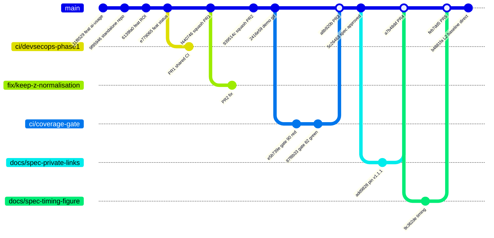
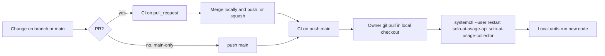

# 18 — Git / release workflow

ทาง change ไปถึง "production" (= checkout บนเครื่องเจ้าของที่ systemd units ชี้อยู่): commit → `main` บน GitHub → CI → เจ้าของ `git pull` ใน checkout แล้ว restart units ด้วยมือ ไม่มี tag / release / deploy job

ใน 31 commits บน `main` มี 3 merge commits (`--no-ff` จาก branch PR #3, #4, #5), 2 squash-merged PRs (#1 `f440746`, #2 `939514c`) และที่เหลือ push ตรง `main` (เช่น `b4881fa` L2 baseline, SPEC-002 ระบุ "Main-only: committed straight to `main`") `main` ไม่มี branch protection / ruleset

Sources: `git log origin/main` (at `b4881fa`), `gh pr list -R bookchaowalit/platform-ai-usage-api --state all`, `gh api repos/bookchaowalit/platform-ai-usage-api/branches/main/protection` (404), `gh api .../rulesets` (`[]`), `docs/OWNER.th.md` (restart command), `specs/002-l2-baseline/spec.md` (Main-only), `.github/workflows/ci.yml`

## Open questions

- local checkout ถูก update อย่างไรและเมื่อไร (manual `git pull`?) — ไม่มีบันทึกใน repo จึงไม่รู้ว่า code ที่รันอยู่ตรงกับ `main` หรือไม่
