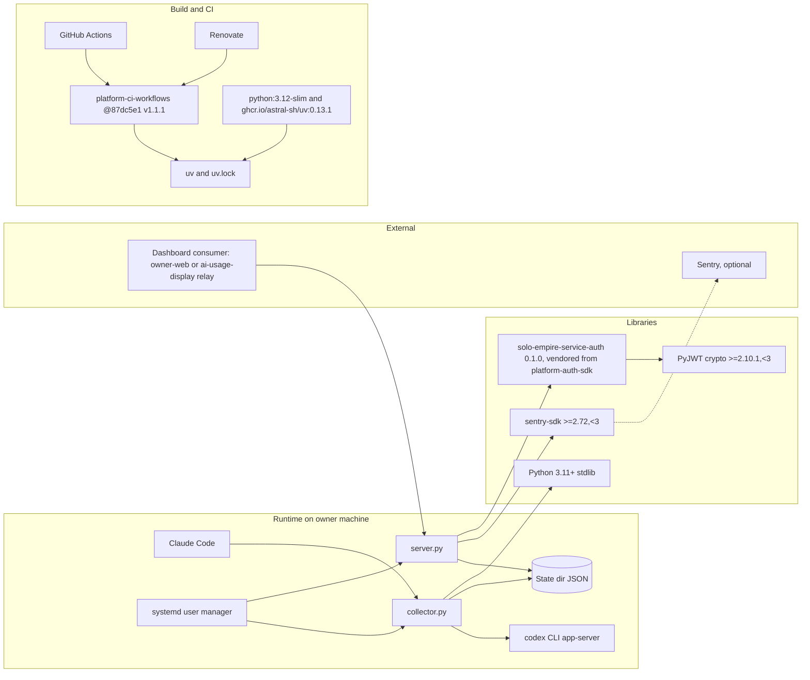

# 19 — Service dependency map

| Dependency | Kind | Required? | Failure effect |
|---|---|---|---|
| State dir | local files | yes | missing → `not_connected`; unreadable → `error`; `/ready` 503 only if `snapshot()` raises |
| codex CLI | subprocess | for Codex data | `codex_not_installed` / `unavailable`; snapshot ages to `stale` |
| Claude Code status line | inbound callback | for Claude data | no refresh → `stale` after 900 s |
| service-auth / PyJWT | library | for API | import failure → API won't start |
| sentry-sdk | library | imported only if `SENTRY_DSN` | none when unset |
| platform-ci-workflows | CI | for CI only | CI fails, runtime unaffected |

Sources: `pyproject.toml`, `uv.lock` (present), `vendor/service-auth/pyproject.toml`, `vendor/service-auth/README.md`, `server.py`, `collector.py`, `model.py`, `error_reporting.py`, `Dockerfile`, `.github/workflows/ci.yml`, `renovate.json`, `systemd/*.service`, `PRODUCT.md`, `docs/OWNER.th.md`
