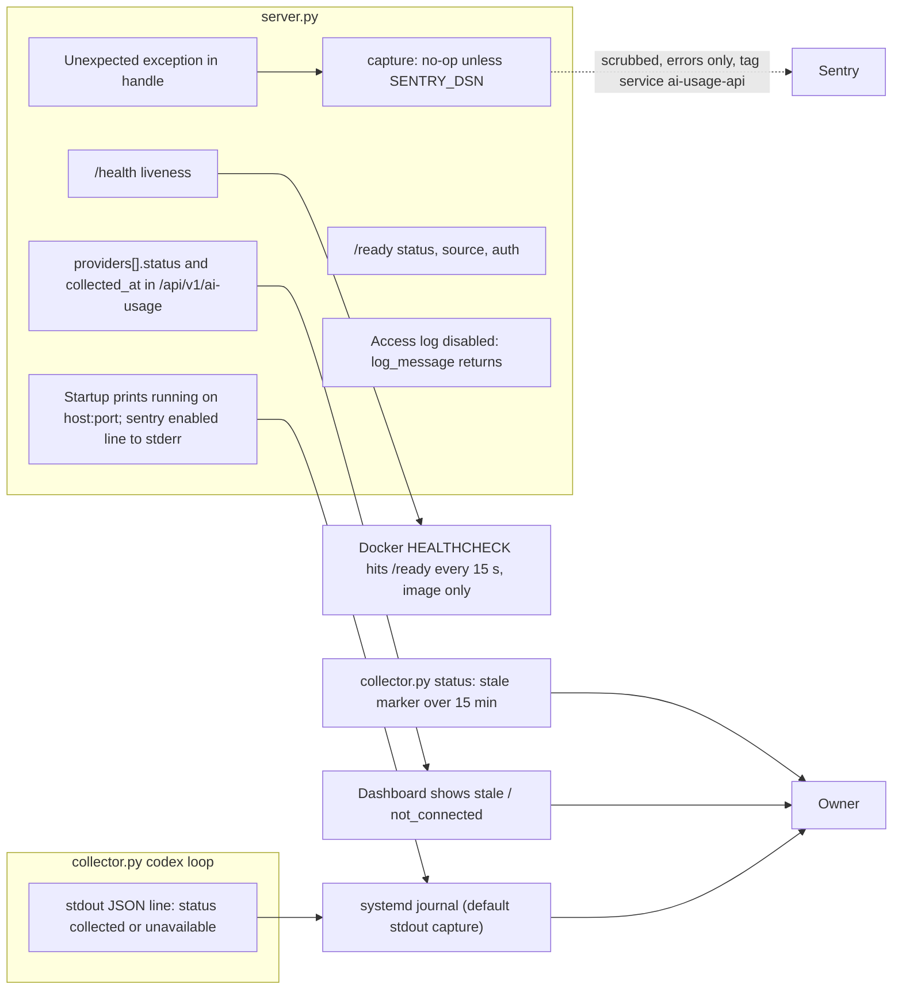

# 20 — Observability

| Signal | Source | Watched by |
|---|---|---|
| Errors (500 path) | `error_reporting.capture` | Sentry, only when `SENTRY_DSN` set (unknown for local units) |
| Liveness / readiness | `/health`, `/ready` | Docker `HEALTHCHECK` (image only); **no uptime monitor targets this API** (PRODUCT.md Measures) |
| Data freshness | `providers[].status` (`stale` > 900 s), `summary.connected` | dashboard / owner |
| Collector success | stdout JSON lines | systemd journal (no alert) |
| CI health | GitHub Actions `CI` | GitHub UI |

- ไม่มี metrics, tracing (`traces_sample_rate=None`), structured request logs, heartbeat หรือ PostHog ใน repo นี้
- PRODUCT.md: `platform-uptime-worker` watches only the `ai-usage-display` relay, not this API

Sources: `server.py`, `error_reporting.py`, `collector.py` (`main` loop prints, `render_status`), `model.py` (`STALE_SECONDS`), `vendor/service-auth/service_auth/__init__.py` (`readiness`), `Dockerfile` (`HEALTHCHECK`), `systemd/*.service`, `PRODUCT.md` (Measures)

## Open questions

- Sentry project / DSN สำหรับ ai-usage-api มีหรือไม่ (PRODUCT.md `[ต้องยืนยัน]`)
- ต้องการ alert เมื่อ collector `unavailable` ต่อเนื่องหรือไม่
