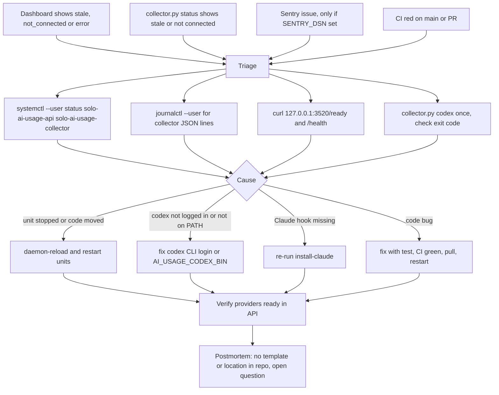

# 21 — Incident response

ไม่มี alert channel อัตโนมัติสำหรับ service นี้ (ไม่มี uptime monitor, ไม่มี Telegram / heartbeat ใน repo; Sentry opt-in) การตรวจพบจึงมาจากเจ้าของเห็นเอง flow ข้างล่างใช้ช่องทางที่มีจริงเท่านั้น

Commands มาจาก repo: restart (`docs/OWNER.th.md`), `collector.py codex` exit 0/1 (`collector.py main`), `/ready` (contract) `journalctl` เป็นคำสั่งมาตรฐาน systemd สำหรับ unit ที่ไม่ได้ตั้ง `StandardOutput` (ไม่ได้ระบุใน repo)

ประวัติเหตุการณ์ที่เห็นได้: CI แดง 2 ครั้งบน PR เท่านั้น (run 39019148129: Ruff `EXE001 Shebang is present but file is not executable`, แก้ใน commit ถัดไปของ PR #1 ภายใน ~1 นาที; run 39534812491: red โดยตั้งใจของ SPEC-001 AC-01) CI บน `main` เขียวทุกครั้ง (8/8)

Sources: `docs/OWNER.th.md`, `collector.py`, `server.py`, `contracts/ai-usage.v1.md`, `error_reporting.py`, `PRODUCT.md` (Measures), `gh run list -R bookchaowalit/platform-ai-usage-api`, `gh run view 39019148129 --log-failed`

## Open questions

- severity, เป้าเวลาแก้ไข และที่เก็บ postmortem สำหรับ service local นี้
- ควรมี alert (เช่น heartbeat) เมื่อ snapshot stale นานหรือไม่
