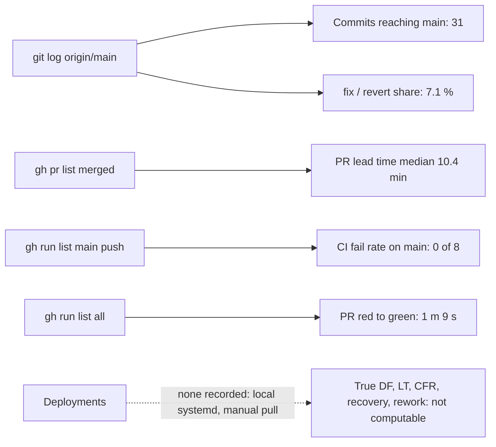

# 22 — DORA metrics

หน้าต่าง: 90 วันถึง 2026-11-04 (`--since=90.days`; commit แรก 2026-10-04 จึงครอบทั้งประวัติ) repo นี้ **ไม่มี deployment ที่บันทึกได้**: runtime คือ systemd units บนเครื่องเจ้าของ (ADR-0001) และไม่มี deploy job / release / tag ดังนั้น metric ที่ผูกกับ deployment วัดแบบแท้ไม่ได้ ใช้ proxy "change reaching `main`" และ CI บน `main` แทน CI เริ่มมีตั้งแต่ 2026-10-17 (PR #1) commit ก่อนหน้านั้นไม่มี CI run

| Metric | How to measure for this repo | Current value (90 d) | Command | Confidence |
|---|---|---|---|---|
| Deployment frequency | ไม่มี deploy record → **cannot compute**. Proxy: commits reaching `main` | **0 recorded deploys**. Proxy: 31 commits on `main` (3 merge commits for PR #3–#5, 2 squash-merged PRs #1–#2, the rest direct pushes) over 19 days of activity | `git log --since=90.days --oneline origin/main \| wc -l` ; `git log --since=90.days --merges --oneline origin/main \| wc -l` | proxy only |
| Lead time for changes | commit → deploy ไม่มี; proxy = PR open → merge | median **10.4 min** (2.3, 6.1, 10.4, 11.9, 12.6 min; n = 5); direct pushes ไม่มี lead time ให้วัด | `gh pr list -R bookchaowalit/platform-ai-usage-api --state merged -L 50 --json createdAt,mergedAt --jq '[.[]\|((.mergedAt\|fromdate)-(.createdAt\|fromdate))/60]\|sort'` | low: n = 5, PR-only |
| Change fail rate | ควรเป็น deploys ที่ทำให้ prod เสีย; proxy = CI failures on push to `main` | **0 / 8 = 0 %** on `main`; all runs 2 / 21 failed, both on PR branches (one intentional red, SPEC-001 AC-01) | `gh run list -R bookchaowalit/platform-ai-usage-api --branch main --event push -L 200 --json conclusion --jq 'group_by(.conclusion)\|map({c:.[0].conclusion,n:length})'` | medium for CI; prod n/a |
| Failed deployment recovery time | ไม่มี deployment และไม่มี red run บน `main` → **cannot compute**. PR proxy: first red → next green on the same PR | n/a on `main`. PR #1: **1 m 9 s** (run 39019148129 created 08:54:56Z → run 39019200441 finished 08:56:05Z, 2026-10-17) | `gh run list -R bookchaowalit/platform-ai-usage-api -L 100 --json databaseId,headBranch,conclusion,createdAt,updatedAt` | low: n = 1, PR proxy |
| Deployment rework rate | ไม่มี deployment; proxy = share of non-merge commits on `main` whose subject starts `fix` / `revert` | **2 / 28 = 7.1 %** (`939514c` fix, `fe7fbfe` Revert) | `git log --since=90.days --no-merges --format=%s origin/main \| grep -ciE '^(fix\|revert)'` ; `git log --since=90.days --no-merges --oneline origin/main \| wc -l` | low: commit-message proxy |

Sources: `git log origin/main` (at `b4881fa`), `gh pr list`, `gh run list`, `gh run view 39019148129 --log-failed`, ADR-0001

## Open questions

- ถ้าต้องการ DORA จริง ต้องมีบันทึก "deploy" ของ local checkout (เช่น commit SHA ที่ unit รันอยู่ หรือ `SENTRY_RELEASE`) — ตอนนี้ไม่มี
